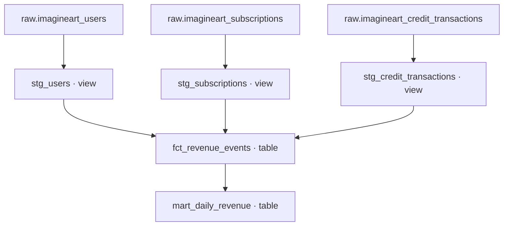

# ContentPulse — dbt Revenue Analytics

A tested PostgreSQL transformation layer that combines subscription upgrades and credit purchases into reusable revenue datasets, attributed to each user's recorded acquisition channel.

An extension of [ContentPulse Analytics](https://github.com/mairajfatima/contentpulse-analytics), an independent BI portfolio project built with synthetic GenAI application data, PostgreSQL, SQL, and Metabase.

## Business problem

ContentPulse's original dashboards explore acquisition, product engagement, monetisation, and sentiment. Their SQL answers individual reporting questions. This extension focuses on the data preparation behind one of those questions:

**How much revenue came from subscription upgrades and credit purchases on each date, and which acquisition channels brought the users who paid?**

The original total-revenue query applies dashboard filters to its subscription component but leaves its credit-purchase component unfiltered. Selecting a period or channel can therefore combine a filtered subscription amount with an unfiltered credit-purchase amount.

The extension provides a common event-level dataset with a consistent revenue date and acquisition channel across both revenue streams. A daily reporting mart aggregates that dataset. Tests check its structure, business arithmetic, and reconciliation to the original sources.

**The original dashboard SQL and Metabase PDF remain separate deliverables. The existing dashboard has not been migrated to these models.** Consumers must query the new mart to use the extension's logic.

## Why dbt

SQL defines the transformation; dbt manages how that transformation is built, checked, and understood.

| Capability | Implementation in this project |
|---|---|
| Source definitions | `source()` identifies the three existing tables in the `raw` schema |
| Dependency management | `ref()` connects staging models, revenue events, and the daily mart |
| Materialisation | Staging models are views; the event fact and reporting mart are tables |
| Automated validation | Generic tests and custom SQL assertions run with `dbt build` |
| Documentation | YAML descriptions, column metadata, and tests appear in generated dbt Docs |
| Lineage | The dependency graph identifies which outputs depend on each source |
| Version control | SQL and YAML are text files that can be reviewed and tracked with Git |

dbt does not load the CSVs or store the data itself. CSVs are loaded into PostgreSQL first. dbt submits transformation SQL to PostgreSQL, which executes it and stores the resulting views and tables. VS Code is the editor; CMD is the command interface used for the verified local build.

## Architecture



Inputs live in `raw`; model outputs live in `analytics`. Tests validate the staging models and revenue outputs. Source loading is a separate prerequisite, not part of `dbt build`.

## Source data and scope

The original repository contains eight CSV datasets. This extension deliberately uses the three required for its revenue question.

| Source table | Grain | Loaded rows |
|---|---|---:|
| `imagineart_users` | One user | 8,000 |
| `imagineart_subscriptions` | One subscription event | 9,630 |
| `imagineart_credit_transactions` | One credit transaction | 2,771 |

Generations, session events, advertising campaigns, reviews, and community activity remain outside this extension. They are relevant to future engagement, conversion, acquisition-cost, and sentiment models.

All data is synthetic. Results demonstrate modelling and validation techniques; they are not actual company revenue or evidence of real customer behaviour.

## Business definitions

### Gross revenue

```text
Gross revenue = subscription upgrade amounts + credit-purchase amounts
```

| Source event | Treatment | Reason |
|---|---|---|
| Subscription `upgrade` | Include `price_usd` | Eligible purchase event under the project's reporting definition |
| Credit `purchase` | Include `cost_usd` | Eligible credit-purchase amount |
| Subscription `account_created` | Exclude | Account lifecycle event, not a purchase |
| Subscription `cancellation` | Exclude | Cancellation event, not a new purchase |
| Credit `refund` | Exclude from gross revenue | Gross revenue is reported before refunds |

This is an event-based portfolio reporting definition. It is not a complete billing ledger or an accounting revenue-recognition implementation. Renewal billing, deferred revenue, taxes, and payment settlement are not modelled.

The source contains 79 credit refunds totalling **−$532.50**. They remain available in staging but are excluded from the revenue fact and daily gross-revenue mart. A net-after-refunds metric is not implemented.

### Dates and acquisition attribution

- Subscription revenue uses the subscription event's `event_date`.
- Credit-purchase revenue uses `transaction_date`.
- Acquisition channel comes from the matching record in `stg_users`, standardised to lowercase with surrounding spaces removed.
- All eligible events for a user receive that recorded channel. This is not multi-touch attribution, and there is no historical channel dimension.
- Revenue by channel is not channel profitability: the extension does not include advertising spend or cost per acquisition.
- Revenue event count measures purchases, not distinct paying users. A single user may contribute several events.
- The daily mart includes observed date/channel combinations; it does not generate a complete calendar with zero-revenue rows.

## Model design

| Model | Grain | Materialisation | Transformation |
|---|---|---|---|
| `stg_users` | One user | View | Standardises acquisition channel; retains user attributes |
| `stg_subscriptions` | One subscription event | View | Standardises event type and plan name |
| `stg_credit_transactions` | One credit transaction | View | Standardises transaction type |
| `fct_revenue_events` | One eligible revenue event | Table | Stacks upgrades and purchases, then adds acquisition channel |
| `mart_daily_revenue` | One revenue date and acquisition channel | Table | Aggregates event count, subscription revenue, credit revenue, and gross revenue |

The raw DDL establishes dates and numeric types; the staging models do not claim additional type conversion beyond that setup.

### Event keys and joins

The fact prefixes subscription IDs with `subscription_` and credit IDs with `credit_`. This creates a common identifier without assuming IDs from different sources cannot overlap.

`UNION ALL` preserves all eligible events. A left join to users attaches acquisition channel without silently dropping unmatched events. Relationship and non-null channel tests detect missing user mappings. Uniqueness tests protect against duplicate event IDs or join multiplication.

### Daily mart fields

| Column | Definition |
|---|---|
| `revenue_date` | Date of the eligible source event |
| `acquisition_channel` | Standardised channel recorded for the user |
| `revenue_event_count` | Number of included upgrade and purchase events |
| `subscription_revenue_usd` | Sum of subscription upgrade amounts |
| `credit_purchase_revenue_usd` | Sum of credit-purchase amounts |
| `gross_revenue_usd` | Sum of both revenue components, before refunds |

## Data quality and verification

The verified selected build completed **5 models and 28 data tests**, with no warnings or errors. Its CLI summary was `PASS=33`: five model builds plus 28 tests, not 33 tests.

| Check | What it detects |
|---|---|
| Unique and non-null source record IDs | Duplicate or unidentified staging records |
| Required user IDs, dates, and amounts | Missing essential values |
| User relationship tests | Events referencing users absent from the user model |
| Unique revenue event IDs | Duplicate fact records |
| Accepted revenue types | Unexpected categories in the revenue fact |
| Non-null acquisition channels | Missing channel mapping in reporting outputs |
| `assert_daily_revenue_valid` | Duplicate date/channel rows, missing numeric components, non-positive event counts, or inconsistent component arithmetic |
| `assert_revenue_reconciles` | Total revenue or event counts differing between eligible raw sources and either revenue output |

Custom SQL tests return failing rows: zero returned rows means the assertion passes. Reconciliation calculates expectations from the sources rather than hard-coding today's totals.

Reconciliation currently validates overall amounts and counts. It does not independently prove every date/channel allocation. Passing tests establish the implemented checks, not universal data correctness.

### Verified snapshot

| Measure | Result |
|---|---:|
| Subscription upgrade events | 1,441 |
| Credit-purchase events | 2,692 |
| Total revenue events | 4,133 |
| Daily date/channel rows | 699 |
| Subscription upgrade revenue | $79,804.71 |
| Credit-purchase revenue | $37,002.00 |
| Gross revenue before refunds | **$116,806.71** |

## Project files

Paths below are relative to the dbt project directory containing `dbt_project.yml`.

| Path | Purpose |
|---|---|
| `dbt_project.yml` | Project name, paths, and model configuration |
| `models/staging/sources.yml` | Three raw-source declarations |
| `models/staging/stg_users.sql` | User staging model |
| `models/staging/stg_subscriptions.sql` | Subscription staging model |
| `models/staging/stg_credit_transactions.sql` | Credit staging model |
| `models/staging/staging.yml` | Staging descriptions and tests |
| `models/marts/fct_revenue_events.sql` | Revenue event fact |
| `models/marts/mart_daily_revenue.sql` | Daily reporting mart |
| `models/marts/marts.yml` | Revenue model descriptions and tests |
| `tests/assert_daily_revenue_valid.sql` | Mart grain and arithmetic assertion |
| `tests/assert_revenue_reconciles.sql` | Source-to-output reconciliation |

dbt's starter example models may still be present. The targeted build command below selects this extension's dependency graph and its associated tests.

## Local setup and reproduction

### Verified environment

Windows 11, Python 3.12.10, dbt Core 1.12.6, dbt-postgres 1.11.0, PostgreSQL 18, and Git. Commands below use Windows CMD and assume the current directory contains `dbt_project.yml`. PostgreSQL must be running; pgAdmin need not remain open.

### 1. Install the project environment

Use a fresh virtual environment. Skip creation if an appropriate project environment already exists.

```bat
py -3.12 -m venv .venv
.venv\Scripts\activate.bat
python -m pip install --upgrade pip
python -m pip install dbt-core==1.12.6 dbt-postgres==1.11.0
```

These pin the directly used dbt packages. A full dependency lock is not provided by these two pins alone.

### 2. Create and load the sources

Create a PostgreSQL database named `contentpulse_dbt`. Connect to it in pgAdmin's Query Tool and run the following once in a fresh database:

```sql
CREATE SCHEMA IF NOT EXISTS raw;

CREATE TABLE raw.imagineart_users (
    user_id TEXT PRIMARY KEY,
    signup_date DATE,
    acquisition_channel TEXT,
    country TEXT,
    platform TEXT,
    plan_tier TEXT,
    age_bucket TEXT,
    app_version TEXT,
    os_version TEXT
);

CREATE TABLE raw.imagineart_subscriptions (
    subscription_event_id TEXT PRIMARY KEY,
    user_id TEXT REFERENCES raw.imagineart_users(user_id),
    event_date DATE,
    event_type TEXT,
    plan_name TEXT,
    price_usd NUMERIC(12, 2)
);

CREATE TABLE raw.imagineart_credit_transactions (
    transaction_id TEXT PRIMARY KEY,
    user_id TEXT REFERENCES raw.imagineart_users(user_id),
    transaction_date DATE,
    transaction_type TEXT,
    credits INTEGER,
    cost_usd NUMERIC(12, 2)
);
```

Download the matching CSVs from the original repository's [Data directory](https://github.com/mairajfatima/contentpulse-analytics/tree/main/Data). In pgAdmin, right-click each table and use **Import/Export Data → Import**. Set CSV format, UTF8 encoding, header on, comma delimiter, double-quote quote/escape characters, and error handling to stop.

Import users first, then subscriptions and credit transactions. The foreign keys require user records to exist before dependent events are loaded. Do not reimport already loaded files: primary keys will reject duplicate IDs.

Verify the source counts against the source-data table above before building models.

### 3. Configure a private connection profile

In `%USERPROFILE%\.dbt\profiles.yml`, configure a profile named `contentpulse` matching the project's `profile` setting:

```yaml
contentpulse:
  target: dev
  outputs:
    dev:
      type: postgres
      host: localhost
      port: 5432
      user: postgres
      password: "{{ env_var('DBT_POSTGRES_PASSWORD') }}"
      dbname: contentpulse_dbt
      schema: analytics
      threads: 4
```

This template reads the password from a local environment variable. Define `DBT_POSTGRES_PASSWORD` privately before running dbt if you use this template. The verified local setup used a private password in the local profile; either method requires a valid database credential. Never commit passwords, `.env` files, or your private `profiles.yml`.

### 4. Validate and build

```bat
dbt debug
dbt build --select +mart_daily_revenue
```

The leading `+` includes upstream models. The build creates three staging views and two revenue tables, and runs associated tests. The table models rebuild their contents on each selected run; incremental processing and scheduled refreshes are not configured. A test failure should be investigated before treating the outputs as ready for consumption.

### 5. Query the reporting output

Run in PostgreSQL or pgAdmin:

```sql
SELECT
    acquisition_channel,
    SUM(gross_revenue_usd) AS gross_revenue_usd
FROM analytics.mart_daily_revenue
GROUP BY acquisition_channel
ORDER BY gross_revenue_usd DESC;
```

To report a specific period, filter `revenue_date` in this mart. Both revenue components use that shared date field.

### 6. Generate and explore documentation

```bat
dbt docs generate
dbt docs serve --port 8080
```

Open [local dbt Docs](http://localhost:8080) while the server is running. Explore model SQL, columns, descriptions, tests, and lineage. The source list is available at `http://localhost:8080/#!/source_list/contentpulse_raw`.

Localhost links are personal development addresses, not public portfolio demos. Regenerate the documentation after changing code or descriptions. Press Ctrl+C to stop serving it.

## Maintaining the extension

Before changing revenue eligibility, attribution, or source assumptions:

1. Identify downstream models through the lineage graph.
2. Update SQL, definitions, and relevant tests together.
3. Run the targeted build and inspect changes in amounts, counts, and grouping.
4. Record the reason and validation results in a Git commit or pull request.

Git-based reviews, automated CI, and deployment can be added to this workflow; a team approval process and production release pipeline have not been implemented here.

## Limitations and next steps

- Local portfolio implementation using a fixed synthetic dataset; no production operation or service-level guarantees.
- No automated ingestion, source freshness monitoring, orchestration, or cloud warehouse deployment.
- No integration of the original Metabase dashboard with the new mart.
- Overall reconciliation can be extended to independent date/channel-level assertions.
- Refund reporting, distinct payer metrics, date spines, and incremental processing are possible extensions, not current features.
- No historical acquisition-channel tracking, multi-touch attribution, or acquisition-cost analysis.
- The mart is documented and tested, but is not described as organisationally certified: no business-owner approval or certification process exists in this portfolio project.

## Relationship to the original project

The original ContentPulse project demonstrates business analysis, relational modelling, dashboard SQL, and visual reporting. This extension adds a focused analytics engineering layer: explicit transformation dependencies, reusable reporting models, automated quality checks, source reconciliation, and generated model documentation.

It demonstrates hands-on **dbt project experience with PostgreSQL**, while preserving the original BI work and clearly separating implemented capabilities from future production practices.
